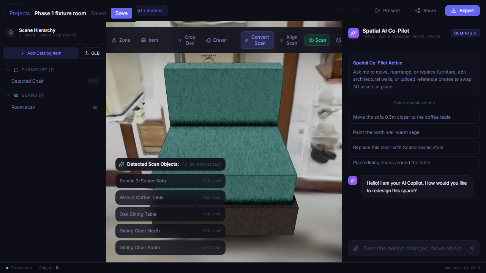
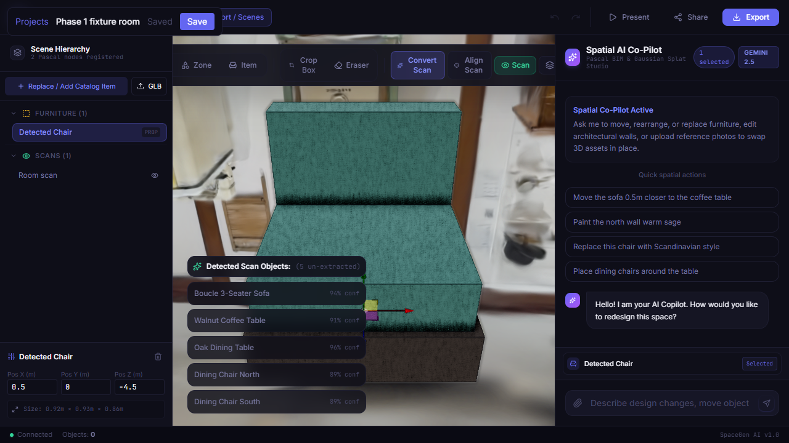
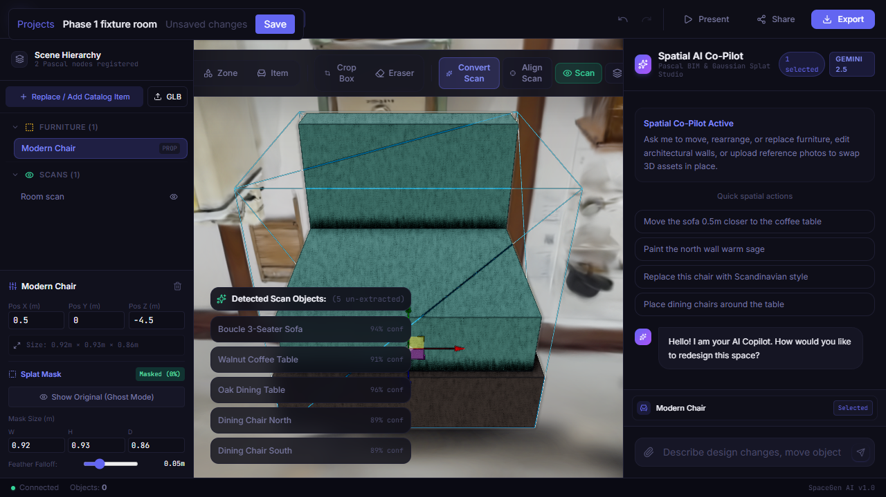
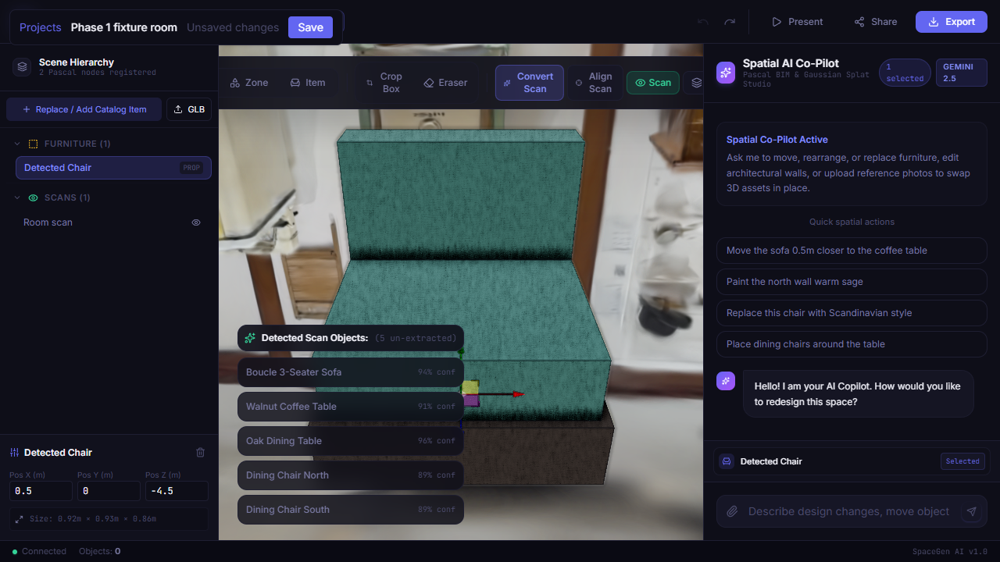
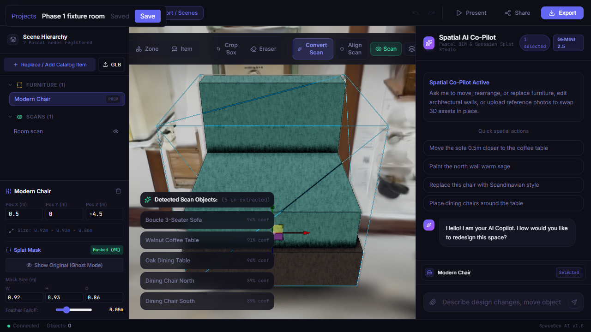

# Phase 1 demo: scan → editable scene → replace → mask → undo/redo → save → reload

This is the end-to-end Phase 1 loop as exercised by `frontend/tests/e2e/phase1-editor-loop.spec.ts` (T09). The test drives the real Next.js app against the real FastAPI backend, which Playwright starts with `uvicorn` on a throwaway `DATA_DIR`. Every screenshot below was produced by that test run. The video is at [`phase1/phase1-editor-loop.webm`](./phase1/phase1-editor-loop.webm).

## Run it

```bash
cd frontend
npm ci
python -m pip install -r ../backend/requirements.txt
npm run build:e2e                      # NEXT_PUBLIC_E2E=1, API → http://127.0.0.1:8765
npx playwright test phase1-editor-loop # starts uvicorn (temp DATA_DIR) + next start
```

Screenshots and the video go to the gitignored `frontend/test-results/screenshots/`. To regenerate this page's evidence, run with `E2E_SCREENSHOT_DIR=../docs/phase1` (PowerShell: `$env:E2E_SCREENSHOT_DIR='..\docs\phase1'`).

Headless Chromium uses SwiftShader (software GL) by default, which renders the editor at about 1 fps. Locally, `playwright.config.ts` passes GPU flags (hardware ANGLE, about 60 fps). Set `E2E_SOFTWARE_GL=1` to reproduce the CI path.

## Fixture

`tests/e2e/support/projects.ts` creates the project through the API:

- `POST /api/projects` with a manifest holding the sample scan `public/Hurstville_Museum_Gallery.sog` (161,576 splats, identity `scanToScene`) and one interpretation detection, `det_chair_01`.
- `POST /api/projects/{id}/assets` uploads the chair proxy GLB.
- `PUT /api/projects/{id}` writes a Pascal `sceneSnapshot` with the scan node and a "Detected Chair" item (`metadata.detectionId = det_chair_01`). The item is placed at (0.5, 0, −4.5), a spot with dense splats. The sample scan is not aligned to the scene frame, and its origin is empty space.

## Steps and what is asserted

1. **Open** `/editor/{id}`. The project loads from the backend and status shows "Saved". The splat layer loads all 161,576 splats, and more than 1,000 of them fall inside the chair's OBB (precondition).

   

2. **Select the detected chair** in the hierarchy. The inspector shows Pos X 0.5 and Pos Z −4.5.

   

3. **Replace with a GLB** via the GLB button. The file is measured, normalized, and uploaded to `POST /api/projects/{id}/assets`. The item becomes "Modern Chair" in one undo step, and a `MaskRegion` is registered on the scan node.
   - One Spark `SplatEdit` is attached to the splat mesh.
   - Inside the mask's projected screen box, about 9% of splat-layer pixels change (`changedFraction > 0.05`, measured with the Pascal canvas hidden).

   

4. **Undo**. The detected chair is back, no edit is attached, and the splat pixels in the box match the pre-replace frame (`changedFraction < 0.01`).

   

5. **Redo**. The replacement and its mask are back, and Redo is disabled again.

6. **Save**. The test reads the project back from the backend and checks:
   - the item is named "Modern Chair" at the same position;
   - `item.asset.src` is `http://127.0.0.1:8765/api/projects/{id}/assets/<sha256>.glb`, not a `blob:` URL, and `GET` returns `model/gltf-binary`;
   - `manifest.assets` has an `AssetRef` with `source: upload`, that URL and the measured dimensions;
   - `manifest.maskRegions` holds exactly the chair's OBB.

7. **Reload** the page. The test checks:
   - same placement (0.5, −4.5);
   - the "Masked (0%)" mask with the same width;
   - one Spark edit attached;
   - splat pixels in the box match the masked frame from step 3 (`< 0.01`);
   - the replacement GLB is drawn (the composited frame differs from the splat-only frame in the box by more than 2%);
   - undo history starts at the loaded state.

   

## Related specs

- `project-conflict.spec.ts`: a concurrent save produces a 409, and the editor offers **Reload latest** or **Overwrite**. Both paths run against the real backend.
- `splat-masking.spec.ts`: masking pixel stats from four distinct camera angles, ghost mode at 25%, and mask resize with undo.

## Known limits

- The sample scan is not aligned to the scene frame (it is upside down at identity `scanToScene`). The fixture places the chair where the scan has content rather than on a real floor.
- Catalog items trust the catalog's declared dimensions. The sample `chair.glb` is about 0.92 m while the catalog fixtures declare 0.55–0.6 m, so a catalog replacement can draw larger than its mask. Uploaded GLBs are measured, so they are not affected.
